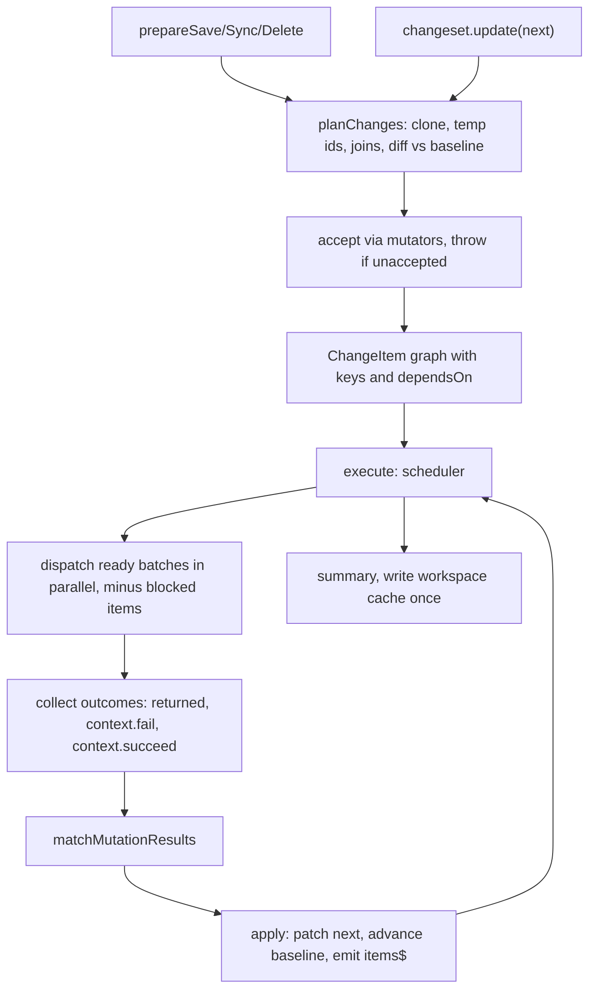

# Mutation changeset rework

## Decisions so far

- A stateful handle: `workspace.in(B).select(s).prepareSave(next, previous?)`, `.prepareSync(next, previous)` and `.prepareDelete(entities)` return an `EntityChangeset`.
- Caller-owned entities are never modified. The changeset returns new `next` and `previous` objects.
- New entities get temporary Ids in the changeset's `next`. They are recognized as new and stripped before dispatch.
- A batch mutator returns only what it persisted and calls `context.fail(input, error, { path? })` for failures. Throwing means the whole batch failed and nothing was persisted. There is no "unknown" outcome.
- Returned entities are matched to inputs by global smallest property difference, with an optional explicit `context.succeed(input, persisted)`. Inputs left unmatched fail.
- Status is exposed as an RxJS `items$` observable plus synchronous getters, with a flat item list. Independent work keeps running when an item fails, and its dependents become blocked. Independent batches run in parallel.
- `m.cancel()` stops dispatching and triggers `context.signal` (an `AbortSignal`).
- `execute()` resolves with a summary and rejects only on programming errors.
- `prepare*()` throws when a change has no mutator.
- After `update(next)`, an item's error is kept until it runs again, and changed items go back to pending.
- The workspace cache is written once, at the end of `execute()`.
- `save()`, `sync()` and `delete()` become shortcuts (prepare + execute) that throw an `EntityMutationError` carrying `.changeset`. The `_next` variants are removed.

## Consumer API sketch

```ts
const changeset = workspace.in(ArtistBlueprint).select({ songs: true }).prepareSave(next, previous);

render(changeset.getItems());           // preview, nothing has run yet
changeset.items$.subscribe(render);     // live: pending/running/succeeded/failed/blocked/cancelled

const summary = await changeset.execute();
// summary.status: "succeeded" | "partial" | "failed" | "cancelled"

if (summary.status !== "succeeded") {
    const form = changeset.getNext();   // generated Ids and temporary Ids already in place
    // ...the end user edits form values (the edits must be based on getNext())...
    changeset.update(editedForm);       // re-diffs against the advanced baseline
    await changeset.execute();          // retries failed, blocked and changed items only
}

const [savedNext, newPrevious] = [changeset.getNext(), changeset.getPrevious()];
```

Item shape: `{ key, schema, type: "create" | "update" | "delete", entity, previous?, path?, dependsOn: key[], status, error?, errorPath? }`.

Batch mutator example:

```ts
addCreateMutator({
    select: { songs: true },
    create: async ({ entities, context }) => {
        const response = await api.createArtists(entities, { signal: context.signal });
        response.errors.forEach(e => context.fail(entities[e.index], e.error, { path: e.field }));
        return response.created;
    },
});
```

One-entity mutators (`addCreateOneMutator`, ...) wrap each call in try/catch and turn a throw into `context.fail(entity, error)` automatically.

## Architecture



Key internals:

- **Baseline:** what is known to be persisted. Stored normalized in an `EntityCache` (as in your staged `previousCache`) together with the root keys. `getPrevious()` builds the tree from it on demand. Diffing gets a fallback: an entity with an Id that has no tree-previous is compared against the normalized baseline. This covers the case where Country was created but Artist failed: Country is found in the baseline and is not changed again.
- **Item keys:** `schemaName + Id`, where the Id may be temporary. Temporary Ids are tracked in a registry local to the changeset, built on [src/elements/entity/assign-temporary-ids.fn.ts](src/elements/entity/assign-temporary-ids.fn.ts). `isNewEntity` checks consult that registry during planning.
- **Scheduler:** each `AcceptedEntityMutation` is one batch. A batch is dispatched once the outside prerequisites of all its items have settled. Items whose prerequisites failed or were blocked are removed from the batch and marked blocked. Dependencies inside an aggregate save stay the mutator's responsibility. This replaces `sortAcceptedMutationsByDependency` for execution; cycle detection is kept and runs at prepare time.
- **Outcome collection:** a per-dispatch collector on `EntityMutationContext` (`fail`, `succeed`, `signal`) keyed by the dispatched copy's identity. It also works for nested objects in aggregate saves. Copies map back to items through a map built in [src/execution/mutation/functions/copy-entities-for-mutation-dispatch.fn.ts](src/execution/mutation/functions/copy-entities-for-mutation-dispatch.fn.ts).
- **Matching:** a new `matchMutationResults` replaces `toEntityPairs` here. Match by Id first. Then, for inputs without an Id that weren't flagged, compute every input/returned difference and assign globally, smallest first. Inputs left over fail with "mutator did not return this entity". The same runs for each nested relation array. Deletes succeed unless flagged or the batch threw.
- **Apply:** created entities get their real Ids in `next` (replacing temporary Ids, with joins rewritten through the existing `EntityChangeDependency.writeIds`). Creates and updates are upserted into the baseline, and deletes are removed from it.

## Files

- New: `src/execution/mutation/entity-changeset.ts` (the handle), `src/execution/mutation/structures/change-item.ts`, `src/execution/mutation/functions/plan-changes.fn.ts`, `src/execution/mutation/functions/execute-changeset.fn.ts` (the scheduler), `src/execution/mutation/functions/match-mutation-results.fn.ts`, `src/execution/mutation/entity-mutation-error.ts`.
- Reworked: [src/execution/entity-workspace.ts](src/execution/entity-workspace.ts) (`#mutate`/`#mutate_next` become changeset creation), [src/execution/entity-mutation-builder.ts](src/execution/entity-mutation-builder.ts) (`prepare*`, shortcuts, `_next` removed), [src/execution/mutation/structures/entity-mutation-context.ts](src/execution/mutation/structures/entity-mutation-context.ts), the four `execute-*-mutation.fn.ts` (they return outcomes instead of writing into originals), [src/execution/mutation/entity-changes-builder.ts](src/execution/mutation/entity-changes-builder.ts) (baseline fallback, temporary Id awareness), [src/execution/entity-schema-scoped-service-container.ts](src/execution/entity-schema-scoped-service-container.ts) (one-mutators use `context.fail` and no longer swallow errors silently), and the mutation function types in [src/execution/mutation/entity-mutation-function.type.ts](src/execution/mutation/entity-mutation-function.type.ts).
- Staged work: keep the cache function signature changes and the `useDeleteSongIfOddId` test fixture. Convert the three `*-next.test.ts` files to the changeset API. Drop the silent error swallowing.
- Docs: replace [docs/mutation-plan.md](docs/mutation-plan.md) with the final design and update `.github/instructions/mutation.instructions.md` (then `npm run sync-cursor-rules`). This also resolves the "delete cleanup TODO" note.

## Open points to confirm while implementing

- If `update()` receives objects that weren't based on `getNext()`, entities created in an earlier round have no Id and would be created again. Plan: document this, and warn when a new entity without an Id closely matches an already-created item.
- Temporary Id format for string Ids versus composite Ids (only the last Id path is generated, as `assignTemporaryIds` does today).

## Tests (vitest, alongside the existing `src/execution/tests/mutation`)

- Preview: items and dependencies are correct, and no mutator is called before `execute()`.
- Partial batch create, update and delete with `context.fail`. Dependents are blocked and unrelated work keeps running.
- Country created, Artist fails, then retry: Country is not dispatched again and Artist gets the Country Id.
- Aggregate save where the root succeeds and a nested song fails.
- `update()` after a validation failure: the error is kept, the item goes back to pending, and the retry succeeds.
- Matching: a reordered return, partial returns, `context.succeed`, and an unmatched input that fails.
- Parallel dispatch, cancel with signal, and the shortcut `save()` throwing `EntityMutationError` with a retry through `.changeset`.
- The existing mutation tests keep passing through the shortcuts.